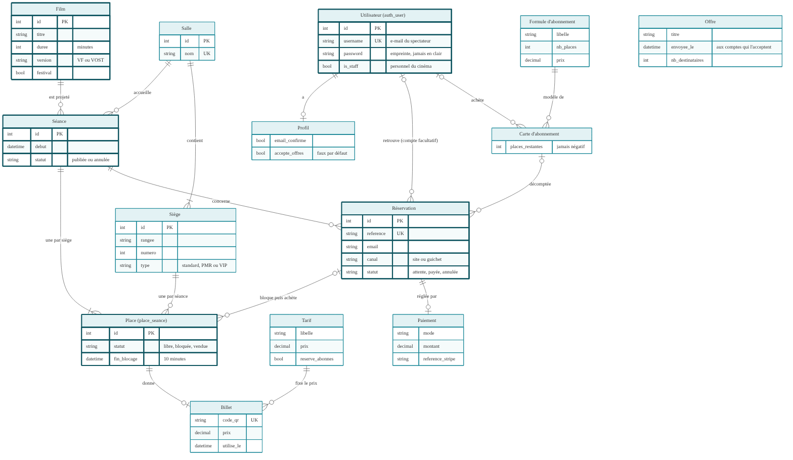

# La base de données

La base est **PostgreSQL** (Amazon RDS en ligne, Docker en local). Elle contient 14 tables.
Les cinq demandées sont en **trait épais** sur le schéma : utilisateurs, films, séances,
réservations et places.



**Lire le schéma** : chaque boîte est une table ; `PK` est l'identifiant, `UK` une valeur
unique. Le symbole au bout d'un trait dit « combien » : `||` exactement un, `o|` zéro ou un,
`o{` zéro ou plusieurs, `|{` un ou plusieurs. Exemple : une séance a **une place par siège**,
et une place appartient à **une seule** séance.

| Fichier | Contenu |
|---|---|
| `modele-de-donnees.png` (source `.mmd`) | le schéma ci-dessus (Mermaid) |
| `schema.sql` | le script SQL commenté de toutes les tables, liens et règles |
| `../schemas/Le_Grand_Cinema_schemas.drawio`, page « Bloc 3 · Figure 2 » | le même modèle en diagramme de classes UML, à ouvrir dans draw.io ([lien sans compte](https://viewer.diagrams.net/?nav=1&title=Le_Grand_Cinema_schemas.drawio#Uhttps%3A%2F%2Fraw.githubusercontent.com%2FNeyliss%2Fle-grand-cinema%2Fdevelop%2Fdocs%2Fschemas%2FLe_Grand_Cinema_schemas.drawio)) |

## Les cinq tables demandées

| Table | Une ligne = | Ce qui compte |
|---|---|---|
| `auth_user` | un utilisateur (personnel ou spectateur avec compte) | mot de passe jamais en clair (empreinte) |
| `catalogue_film` | un film | durée, version VF/VOST, film du festival |
| `catalogue_seance` | une projection d'un film dans une salle | début, statut (publiée ou annulée) |
| `reservation_reservation` | une commande (site ou guichet) | référence unique, compte **facultatif** |
| `reservation_placeseance` | un siège pour une séance | statut libre / bloquée / vendue |

## Les règles portées par la base

1. **Un siège ne se vend qu'une fois** : la contrainte `place_unique_par_seance (seance_id, siege_id)`
   rend un doublon impossible, même si le site et le guichet vendent au même moment.
2. **Un siège existe une seule fois dans sa salle** : `siege_unique_par_salle`.
3. **Un billet par place**, avec un code QR unique ; **un paiement par réservation**.
4. **Une carte d'abonnement ne descend jamais sous zéro** : `CHECK (places_restantes >= 0)`.
5. **Réserver sans compte** : `compte_id` peut rester vide.
6. **RGPD** : supprimer un compte vide le lien (`SET NULL`) sans effacer les ventes, qui restent
   pour la comptabilité, sans nom ni adresse.
7. **Pas de donnée bancaire** : seulement la référence du paiement chez Stripe.

## D'où vient ce script, et comment il est vérifié

Les tables sont créées par Django à partir des modèles (`models.py` de chaque partie), avec
`python manage.py migrate`. Le script `schema.sql` en est la version lisible. Il a été exécuté sur
PostgreSQL 16 puis comparé aux tables créées par Django : **mêmes 98 colonnes, mêmes 30
contraintes (clés, valeurs uniques, contrôles) et mêmes 15 liens**.

```bash
createdb verif && psql -d verif -f docs/base-de-donnees/schema.sql   # le script s'exécute sans erreur
```

Les règles « que faire quand on supprime » (`ON DELETE`) sont celles des modèles Django
(`on_delete=`) : `RESTRICT` (interdit, ex. supprimer un film qui a des séances), `CASCADE`
(supprime aussi, ex. les places d'une séance) et `SET NULL` (garde la ligne, sans le lien).
